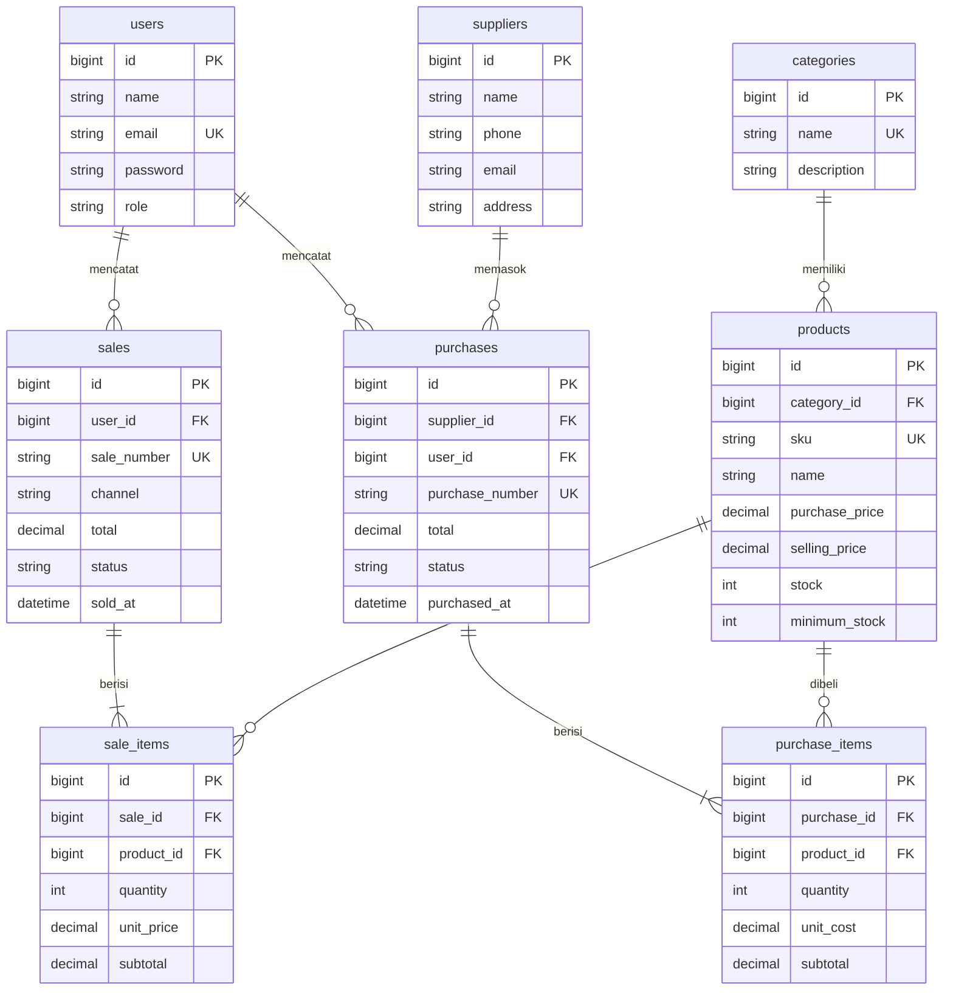

# ZIRA NUSA INVENTARIA

Aplikasi inventaris dan penjualan untuk usaha **ZIRA BEAUTY** (kosmetik, skincare, makeup, parfum, body care, hair care, beauty tools).
Dibangun dengan **Laravel 12 (MVC) + MySQL + Eloquent ORM** sebagai tugas *UTS Integrated Laravel Project — Inventory & Sales Management System*.

> Basis kode: project `Nusa Stationery / Nurhazira` (Laravel 12, login, middleware role, stok masuk/keluar, struk, portal pelanggan).
> Identitas, tema, struktur data, dan logika transaksi dikembangkan menjadi ZIRA NUSA INVENTARIA. Versi Laravel **tidak di-upgrade** (tetap `^12.0`, PHP `^8.2`).

---

## 1. Ringkasan fitur

| Modul | Isi |
|---|---|
| Autentikasi | Login/logout, password di-hash, rute terproteksi, CSRF, throttle login |
| Role | **Admin/Owner**, **Staff**, **Pelanggan** (portal belanja dipertahankan dari project awal) |
| Dashboard | Total produk/kategori/pemasok, stok rendah, penjualan hari ini/bulan ini/total, ringkasan pembelian, grafik 7 hari, produk terlaris, transaksi terbaru |
| Kategori | CRUD + validasi (Skincare, Makeup, Parfum, Body Care, Hair Care, Beauty Tools di-seed) |
| Produk | CRUD, SKU unik, harga beli/jual, stok, stok minimum, cari (nama/SKU), filter kategori & status stok, pagination, halaman detail |
| Pemasok | CRUD (nama, telepon, email, alamat) |
| Pembelian | Pilih pemasok, banyak produk per transaksi, subtotal & total dihitung server, stok **bertambah**, bisa dibatalkan (stok dikurangi lagi) |
| Penjualan | Banyak produk per transaksi, harga dari database, stok **berkurang**, ditolak jika stok kurang, struk cetak/PDF, bisa dibatalkan (stok dipulihkan) |
| Laporan | Riwayat pembelian & penjualan (cari nomor, filter tanggal & status, pagination), detail transaksi, daftar stok rendah, laporan ringkasan per periode |
| Pengguna | Admin mengelola akun dan role |

### Matriks hak akses (diperiksa di server: middleware `can:`, FormRequest `authorize()`, Policy)

| Aksi | Admin/Owner | Staff | Pelanggan |
|---|:-:|:-:|:-:|
| Dashboard, lihat produk/kategori/pemasok, stok rendah | ✔ | ✔ | ✘ |
| CRUD kategori, produk, pemasok | ✔ | ✘ | ✘ |
| Kelola pengguna & role | ✔ | ✘ | ✘ |
| Buat pembelian / penjualan | ✔ | ✔ | ✘ |
| Lihat riwayat transaksi | semua | milik sendiri | — |
| Batalkan transaksi | ✔ | ✘ | ✘ |
| Laporan ringkasan | ✔ | ✘ | ✘ |
| Portal belanja & struk sendiri | ✘ | ✘ | ✔ |

## 2. Persyaratan

- PHP **8.2+** dengan ekstensi: `mbstring`, `openssl`, `pdo_mysql`, `tokenizer`, `xml`, `ctype`, `json`, `fileinfo`
- Composer 2
- MySQL / MariaDB (mis. XAMPP, Laragon)
- Node.js **tidak diperlukan** (CSS ada di `public/css/zira.css`, tanpa build)

## 3. Instalasi (environment baru)

```bash
# 1. Masuk ke folder project (folder yang berisi artisan dan composer.json)
cd ZIRA_NUSA_INVENTARIA

# 2. Pasang dependency
composer install

# 3. Salin konfigurasi lalu buat APP_KEY
cp .env.example .env            # Windows: copy .env.example .env
php artisan key:generate

# 4. Buat database kosong di MySQL, mis.:
#    CREATE DATABASE zira_nusa_inventaria CHARACTER SET utf8mb4 COLLATE utf8mb4_unicode_ci;
#    lalu sesuaikan DB_DATABASE / DB_USERNAME / DB_PASSWORD di file .env

# 5. Buat tabel + isi data demo
php artisan migrate --seed

# 6. Jalankan
php artisan serve               # buka http://127.0.0.1:8000
```

Mengulang dari awal (hanya untuk database demo, **menghapus semua data**): `php artisan migrate:fresh --seed`.
Menjalankan seeder lagi tanpa `migrate:fresh` aman: master data memakai `firstOrCreate` dan transaksi contoh hanya dibuat bila belum ada transaksi.

### Alternatif tanpa MySQL (SQLite)

Ubah di `.env`: `DB_CONNECTION=sqlite` dan hapus baris `DB_HOST/PORT/DATABASE/USERNAME/PASSWORD`; buat berkas kosong `database/database.sqlite`, lalu `php artisan migrate --seed`.

## 4. Akun demo (khusus pengujian — bukan kredensial asli)

| Role | Email | Password |
|---|---|---|
| Admin/Owner | `admin@zirabeauty.test` | `password123` |
| Staff | `staff@zirabeauty.test` | `password123` |
| Pelanggan | `customer@zirabeauty.test` | `password123` |

Untuk penggunaan nyata: ganti password, hapus kotak akun demo di `resources/views/login.blade.php`, set `APP_ENV=production` dan `APP_DEBUG=false`.

## 5. Pengujian otomatis

```bash
php artisan test        # atau: composer test
```

Test memakai SQLite in-memory (lihat `phpunit.xml`) sehingga tidak menyentuh database MySQL. Daftar skenario ada di `docs/TEST_CASES.md`.

## 6. Arsitektur (sesuai PPT UTS)

```
Route (routes/web.php)  ->  Middleware (auth, can:...)  ->  Controller
   ->  FormRequest (validasi + authorize)  ->  Service (logika bisnis)  ->  Eloquent Model  ->  MySQL  ->  Blade
```

| Lapisan | Lokasi |
|---|---|
| Routes (named + resource) | `routes/web.php` |
| Gate & Policy | `app/Providers/AppServiceProvider.php`, `app/Policies/` |
| Controller | `app/Http/Controllers/` |
| Validasi server | `app/Http/Requests/` (+ pesan Indonesia di `lang/id/validation.php`) |
| Logika transaksi | `app/Services/SaleService.php`, `app/Services/PurchaseService.php` |
| Model & relasi | `app/Models/` |
| Migration & seeder | `database/migrations/`, `database/seeders/DatabaseSeeder.php` |
| View (Blade) | `resources/views/` |

### Aturan bisnis & di mana ditegakkan

| Aturan | Penegakan |
|---|---|
| SKU unik | `Rule::unique` di `ProductRequest` **dan** unique index di migration |
| Kuantitas > 0, harga ≥ 0 | `SaleRequest` / `PurchaseRequest` dan pemeriksaan ulang di service |
| Total dihitung server | Service menghitung `qty × harga dari DB`; input `total`/`unit_price` dari browser diabaikan |
| Header + item + stok atomik | `DB::transaction()` di service; error → rollback seluruhnya |
| Stok tidak boleh negatif | Cek `stock < qty` sebelum menulis **dan** `UPDATE ... WHERE stock >= qty` (pengaman kedua) |
| Cegah overselling bersamaan | `lockForUpdate()` pada baris produk (urut id, mencegah deadlock) |
| Pembatalan memulihkan stok | `cancel()` di service; pembatalan **pembelian** ditolak bila stok saat ini kurang dari jumlah beli |
| Produk bertransaksi tidak boleh dihapus | `ProductController@destroy` memeriksa riwayat + FK `restrictOnDelete` |
| Kategori/pemasok/pengguna yang dipakai tidak boleh dihapus | Pemeriksaan di controller + FK `restrictOnDelete` |
| Stok hanya berubah lewat transaksi | Edit produk tidak memuat field stok |

## 7. ERD



Relasi Eloquent: `Category hasMany Product`; `Product belongsTo Category`, `hasMany PurchaseItem`, `hasMany SaleItem`; `Supplier hasMany Purchase`; `Purchase belongsTo Supplier/User`, `hasMany PurchaseItem`; `Sale belongsTo User`, `hasMany SaleItem`; `PurchaseItem/SaleItem belongsTo` induk transaksi dan `Product`.
Foreign key berada di tabel *detail/anak* (mis. `sale_items.sale_id`) karena satu penjualan memiliki banyak item (hasMany), sedangkan setiap item hanya milik satu penjualan (belongsTo).

## 8. Keterbatasan yang diketahui

- Transaksi pembelian dianggap **terkonfirmasi saat disimpan** (tidak ada status draft/pending).
- Staff hanya melihat transaksi yang ia catat sendiri; Admin melihat semua.
- Nomor transaksi dibuat berurutan per hari (`SAL-YYYYMMDD-0001`); dua transaksi bersamaan pada produk berbeda berpotensi bentrok nomor (dilindungi unique index → request gagal dan dapat diulang).
- Tidak ada pembayaran online nyata; portal pelanggan hanya pesanan demo.
- Struk memakai cetak browser (Ctrl+P → Simpan sebagai PDF).
- **Status pengujian: lihat `docs/RINGKASAN_PERUBAHAN.md`.** Kode dan test ditulis tanpa PHP di lingkungan pembuat, sehingga harus dijalankan dulu di komputer Anda (`php artisan test`) sebelum diklaim lulus.
